# Issue Dependency Graph

Auto-generated by `scripts/gen/generate-issue-index.py`. Do not edit manually.

## Mermaid graph

```mermaid
graph LR
  I474["474 Async component support (v5)"]
  I669["669 669 — WIT import IDE and formatter surface"]
  I677["677 677 — Component developer experience (CLI, cookbooks, diagnostics explain)"]
  I678["678 678 — Verification gates: stale docs, release checklist, and close-gate coverage"]
  I680["680 680 — Target tier honesty audit (stable / smoke / scaffold / none)"]
  I681["681 681 — Stdlib manifest reachability contract audit"]
  I684["684 684 — False-done and limited-scope done issue re-audit program"]
  I685["685 685 — IDE / Playground / Extension product-claim vs compiler gate audit"]
  I686["686 Wasm GC Selfhost Implementation"]
  I691["691 691 — `Iterator` trait, lazy adapters, and `FromIterator` / `collect`"]
  I693["693 693 — `Read` / `Write` / `BufRead` / `Seek` traits and IO unification"]
  I694["694 694 — `Error` trait and unified error type ecosystem"]
  I695["695 695 — `Ord` / `PartialOrd` traits and comparison-based algorithms"]
  I702["702 702 — Integrate `to_string` / `clone` / `hash` builtins into trait dispatch"]
  I708["708 708 — `TryFrom` / `TryInto` traits for fallible conversions"]
  I715["715 715 — In-file test coverage targets for compiler and stdlib"]
  I718["718 718 — Stdlib free-function → method/trait migration inventory"]
  I721["721 Final Types (`sub final`) を全 struct に適用"]
  I723["723 Wasm Exception Handling (`exnref`) 統合の検討"]
  I728["728 728 — WIR / backend target IR for ADR-007 multi-target separation"]
  I729["729 729 — Intrinsic layer separation (unblocked epic)"]
  I760["760 ADR 台帳の規則追従 — research/plans 分離と supersession 整合"]
  I791["791 791 — Eliminate the Ark canonical parser baseline"]
  I815["815 815 — Diagnostic/T3 compile skips"]
  I818["818 818 — CoreOpRegistry production scaffold exit"]
  I825["825 AST cache format repair (not “re-enable as-is”)"]
  I849["849 849 — native-executor wasm32-gc S3 validation drift (func 118)"]
  I851["851 851 — セルフホストコンパイラ中核再構築（wasm32-gc overlay）"]
  I858["858 858 — 演算子 Trait へ統一し magic method を退役する"]
  I859["859 859 — 公開 API を generic Trait 面へ統一する"]
  I861["861 861 — 数値の暗黙変換を廃止し明示変換を定義する"]
  I862["862 862 — 算術 edge case と評価順序を仕様化する"]
  I863["863 863 — String / Unicode semantics を確定する"]
  I864["864 864 — let-generalization / value restriction を形式化する"]
  I866["866 866 — source module の import / use 構文を整理する"]
  I868["868 868 — Prelude / boolean literal / keyword policy を固定する"]
  I869["869 869 — multi-clause / where / semicolon grammar を確定する"]
  I870["870 870 — target capability / Memory64 / host profile を分解する"]
  I876["876 876 — stability / current-state / redesign の分類を整合する"]
  I682["682 682 — Component / WIT product-claim verification audit"]
  I698["698 698 — std::simd explicit SIMD library API and v128 first-class type"]
  I801["801 GC 完了までのプラン"]
  I860["860 860 — Iterator Trait 体系を統合完了する"]
  I857["857 857 — `?` / conversion / Error sentinel を整理する"]
  I697["697 697 — `Vec<T>` operation extension (windows / chunks / retain / sort_by / drain / splice)"]
  I703["703 703 — Monomorphic API cutover (ADR-036 D2 + ADR-046)"]
  I719["719 719 — `arukellt test` execution harness (ADR-041 Phase 2)"]
  I799["799 799 — CQ-18: code-quality closed-loop strict final audit"]
  I865["865 865 — Hygienic desugaring と f-string lowering を実装する"]
  I814["814 814 — Formatter/parser exceptions (23 files)"]
  I850["850 850 — Compiler phase-arena implementation (wasm32-gc host overlay)"]
  I867["867 867 — `pub` / Component export / WIT import 境界を分離する"]
  I871["871 871 — Wasm GC aggregate lowering を完成する"]
  I873["873 873 — linear-memory tracing GC fallback runtime を実装する"]
  I683["683 683 — User-facing executable example audit (Quickstart / skip-doc-check)"]
  I699["699 699 — T4 LLVM native SIMD lowering for std::simd"]
  I709["709 709 — Stdlib trait-first API policy and free-function eradication"]
  I872["872 872 — Wasm GC closure / collection lowering を完成する"]
  I874["874 874 — fallback managed-value lowering を実装する"]
  I710["710 710 — Linear collection ADTs: `Deque<T>` / queue / stack / list type surface"]
  I875["875 875 — wasm32-gc / fallback の意味論 parity を証明する"]
  I711["711 711 — Rich stdlib reference docs with crates.io / docs.rs / JSR readability"]
  I877["877 877 — normative examples と操作的意味論を実行可能にする"]
  I878["878 878 — Language v2 compatibility migration を完了する"]
  I879["879 879 — Wasm GC / fallback の性能・サイズ receipt を取得する"]
  I712["712 712 — LLM code quality signal gates for readability and stdlib misuse"]
  I880["880 880 — Language v2 最終 close audit を実施する"]
  I713["713 713 — Stdlib and Arukellt code best-practices doc pack"]
  I852["852 852 — 言語 v2 意味論再設計 umbrella"]
  I680 --> I682
  I686 --> I698
  I686 --> I801
  I691 --> I860
  I694 --> I857
  I691 --> I697
  I695 --> I697
  I691 --> I703
  I695 --> I703
  I715 --> I719
  I715 --> I799
  I729 --> I865
  I791 --> I814
  I851 --> I850
  I866 --> I867
  I870 --> I871
  I870 --> I873
  I682 --> I683
  I698 --> I699
  I691 --> I709
  I695 --> I709
  I697 --> I709
  I703 --> I709
  I859 --> I872
  I860 --> I872
  I871 --> I872
  I859 --> I874
  I860 --> I874
  I873 --> I874
  I691 --> I710
  I697 --> I710
  I709 --> I710
  I857 --> I875
  I858 --> I875
  I861 --> I875
  I862 --> I875
  I863 --> I875
  I864 --> I875
  I865 --> I875
  I867 --> I875
  I868 --> I875
  I869 --> I875
  I871 --> I875
  I872 --> I875
  I874 --> I875
  I681 --> I711
  I709 --> I711
  I710 --> I711
  I857 --> I877
  I858 --> I877
  I860 --> I877
  I875 --> I877
  I876 --> I877
  I875 --> I878
  I876 --> I878
  I871 --> I879
  I872 --> I879
  I874 --> I879
  I875 --> I879
  I709 --> I712
  I711 --> I712
  I877 --> I880
  I878 --> I880
  I879 --> I880
  I709 --> I713
  I711 --> I713
  I712 --> I713
  I880 --> I852
```

## Adjacency list

- **474** depends on: 035, done), 074; blocks: none
- **669** depends on: 652, done); blocks: none
- **677** depends on: 475, 485; blocks: none
- **678** depends on: none; blocks: none
- **680** depends on: 679; blocks: 682
- **681** depends on: 679; blocks: 711
- **684** depends on: none; blocks: none
- **685** depends on: 679; blocks: none
- **686** depends on: none; blocks: 698, 801
- **691** depends on: 688, 707; blocks: 697, 703, 709, 710, 860
- **693** depends on: 688, 692; blocks: none
- **694** depends on: 690, 692; blocks: 857
- **695** depends on: 688; blocks: 697, 703, 709
- **702** depends on: 688, 700, 692; blocks: none
- **708** depends on: 692, 707; blocks: none
- **715** depends on: 041, done); blocks: 719, 799
- **718** depends on: 700, 701; blocks: none
- **721** depends on: none; blocks: none
- **723** depends on: none; blocks: none
- **728** depends on: none; blocks: none
- **729** depends on: 843; blocks: 865
- **760** depends on: none; blocks: none
- **791** depends on: 785; blocks: 814
- **815** depends on: none; blocks: none
- **818** depends on: 798, 816, 817, 819, 820, 821, 822; blocks: none
- **825** depends on: 823; blocks: none
- **849** depends on: none; blocks: none
- **851** depends on: 827; blocks: 850
- **858** depends on: 856; blocks: 875, 877
- **859** depends on: 856; blocks: 872, 874
- **861** depends on: none; blocks: 875
- **862** depends on: none; blocks: 875
- **863** depends on: 854; blocks: 875
- **864** depends on: 856; blocks: 875
- **866** depends on: none; blocks: 867
- **868** depends on: none; blocks: 875
- **869** depends on: none; blocks: 875
- **870** depends on: none; blocks: 871, 873
- **876** depends on: none; blocks: 877, 878
- **682** depends on: 679, 680; blocks: 683
- **698** depends on: 686, 649; blocks: 699
- **801** depends on: 686; blocks: none
- **860** depends on: 691, 856; blocks: 872, 874, 877
- **857** depends on: 694, 856; blocks: 875, 877
- **697** depends on: 691, 695; blocks: 709, 710
- **703** depends on: 700, 701, 691, 695; blocks: 709
- **719** depends on: 715; blocks: none
- **799** depends on: 715, 796, 797; blocks: none
- **865** depends on: 729; blocks: 875
- **814** depends on: 791; blocks: none
- **850** depends on: 851; blocks: none
- **867** depends on: 866; blocks: 875
- **871** depends on: 854, 870; blocks: 872, 875, 879
- **873** depends on: 870; blocks: 874
- **683** depends on: 679, 682; blocks: none
- **699** depends on: 649, 698; blocks: none
- **709** depends on: 691, 695, 697, 703; blocks: 710, 711, 712, 713
- **872** depends on: 855, 859, 860, 871; blocks: 875, 879
- **874** depends on: 854, 855, 859, 860, 873; blocks: 875, 879
- **710** depends on: 691, 697, 701, 707, 709; blocks: 711
- **875** depends on: 857, 858, 861, 862, 863, 864, 865, 867, 868, 869, 871, 872, 874; blocks: 877, 878, 879
- **711** depends on: 681, 709, 710; blocks: 712, 713
- **877** depends on: 857, 858, 860, 875, 876; blocks: 880
- **878** depends on: 875, 876; blocks: 880
- **879** depends on: 871, 872, 874, 875; blocks: 880
- **712** depends on: 709, 711; blocks: 713
- **880** depends on: 877, 878, 879; blocks: 852
- **713** depends on: 709, 711, 712; blocks: none
- **852** depends on: 880; blocks: none
