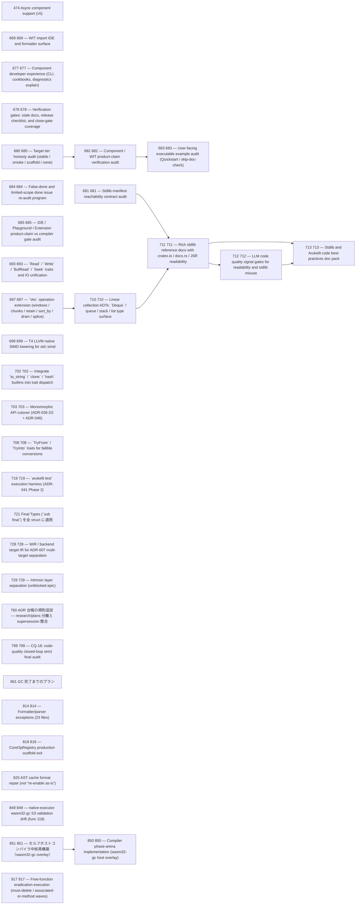

# Issue Dependency Graph

Auto-generated by `scripts/gen/generate-issue-index.py`. Do not edit manually.

## Mermaid graph

## Adjacency list

- **474** depends on: 035, done), 074; blocks: none
- **669** depends on: 652, done); blocks: none
- **677** depends on: 475, 485; blocks: none
- **678** depends on: none; blocks: none
- **680** depends on: 679; blocks: 682
- **681** depends on: 679; blocks: 711
- **684** depends on: none; blocks: none
- **685** depends on: 679; blocks: none
- **693** depends on: 688, 692; blocks: none
- **697** depends on: 691, 695; blocks: 710
- **699** depends on: 649, 698; blocks: none
- **702** depends on: 688, 700, 692; blocks: none
- **703** depends on: 700, 701, 691, 695; blocks: none
- **708** depends on: 692, 707; blocks: none
- **719** depends on: 715; blocks: none
- **721** depends on: none; blocks: none
- **728** depends on: none; blocks: none
- **729** depends on: 843; blocks: none
- **760** depends on: none; blocks: none
- **799** depends on: 715, 796, 797; blocks: none
- **801** depends on: 686; blocks: none
- **814** depends on: 791; blocks: none
- **818** depends on: 798, 816, 817, 819, 820, 821, 822; blocks: none
- **825** depends on: 823; blocks: none
- **849** depends on: none; blocks: none
- **851** depends on: 827; blocks: 850
- **917** depends on: 709; blocks: none
- **682** depends on: 679, 680; blocks: 683
- **710** depends on: 691, 697, 701, 707, 709; blocks: 711
- **850** depends on: 851; blocks: none
- **683** depends on: 679, 682; blocks: none
- **711** depends on: 681, 709, 710; blocks: 712, 713
- **712** depends on: 709, 711; blocks: 713
- **713** depends on: 709, 711, 712; blocks: none
